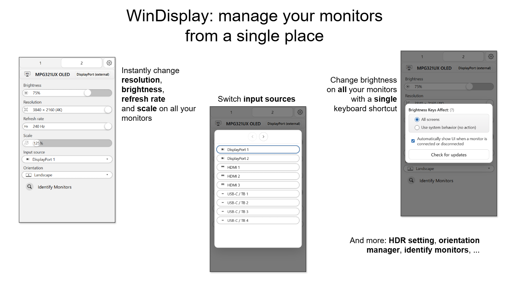

## WinDisplay

Like BetterDisplay, but for Windows.

- Change resolution and refresh rate of your monitors from your system tray.
- Change monitor brightness
- Change monitor orientation
- Enable and disable HDR
- Change scale without logging out
- Change input source

More functions coming!

## Installation

Download latest executable from [the release page](https://github.com/zpix1/windisplay/releases/latest).

## Brightness shortcuts

In Settings, select **All screens** under **Brightness Keys Affect** to enable
global brightness shortcuts. Click the brightness down or up field and press a
key, optionally with Ctrl, Alt, Shift, or the Windows key. Restart WinDisplay
to apply changes. The defaults are F14 (down) and F15 (up), in 5% steps.

If your keyboard has programmable buttons, configure them to send your chosen
shortcuts. Avoid shortcuts used by Windows or another app; unavailable shortcuts
cannot be registered. Unmodified keys may be intercepted throughout Windows.
Brightness changes depend on the monitor's supported control method.

## CLI Usage

For CLI usage instructions, see [CLI_USAGE.md](CLI_USAGE.md).

## Contributors

- [zpix1](https://github.com/zpix1) - Ivan Baksheev
- [exSnake](https://github.com/exSnake)
- [Cesarsk](https://github.com/Cesarsk)
